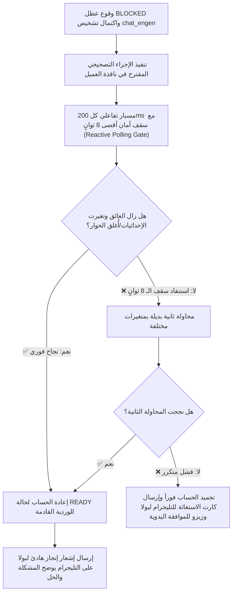

# 🤖 وثيقة المواصفات الهندسية: محرك الذكاء الاصطناعي وحل المشاكل الحرجة
## Engine Specification Document: AI Triage & Visual Solver Engine (v1.0)
> **النظام:** منظومة أتمتة OSRS Enterprise Automation  
> **المحرك:** `AI Triage & Visual Solver Engine` (المحرك الخامس — الطبيب الاستشاري وركيزة الاستدامة)  
> **المرجع التقني المعتمد للبوابة:** [`https://github.com/belalalibb/chat_engen.git`](https://github.com/belalalibb/chat_engen.git)  
> **المصمم والمعماري الاستشاري:** بولا (Bolla) & زيزو (Zizo)  
> **حالة الوثيقة:** معتمدة رسمياً للتنفيذ  
> **المسار المستهدف للكود:** `engines/ai_triage_solver/`  

---

## 📌 1. تذكير بالمعايير الحساسة من المحركات السابقة:

1. **من المحرك الأول (`Task Worker`):**
   * عند إعلان العامل حالة `BLOCKED` لعائق في اللعبة، يتم تجميد حركة الحساب مؤقتاً والتقاط لقطة شاشة واقتطاع آخر 25 سطر من السجل لتسليمها لمحرك الـ AI.
2. **من المحرك الثاني (`Accounts Manager`):**
   * الحساب المتعثر يتحول لحالة `BLOCKED_PENDING_TRIAGE` ويتم استبداله في السلوت فوراً بحساب جاهز آخر، بحيث تجري معالجة الـ AI في الخلفية دون تعطيل الوردية.
3. **من المحرك الثالث (`Telegram Guardian`):**
   * استلام تقارير الحلول الناجحة لبثها للمستخدم، أو استلام تقارير التصعيد المصحوبة بأزرار الموافقة والتجميد في الحالات المعقدة.
4. **من المحرك الرابع (`Master Orchestrator`):**
   * المايسترو هو من ينفذ الأمر التصحيحي المعزول على نافذة الحساب المعني بناءً على توجيه الـ AI.

---

## 🎯 2. الهوية والوظيفة الجوهرية (Identity & Core Mission)

* **الوظيفة الجوهرية الكبرى:** **تقليل التدخل البشري لأقصى درجة وتوفير الاستدامة التامة للمزرعة 24/7**، بحيث تعمل المزرعة بمفردها وتحل مشاكلها ذاتياً دون الحاجة لأن يظل بولا جالساً أمام الشاشات.
* **دستور الأمان والحوكمة (The Ironclad Constraints):**
  1. **التدخل في الحالات الحرجة فقط (Critical-Only Trigger):** لا يُستدعى الذكاء الاصطناعي في دورات اللعب العادية إطلاقاً لمنع استنزاف الوقت والتوكنات؛ يتدخل حصراً عند وقوع تعثر حقيقي (`BLOCKED`).
  2. **حظر تعديل السكربتات دون إذن صريح (Zero Script Mutation):** الذكاء الاصطناعي هو **طبيب تشغيل رن تايم (Runtime Action Solver)**؛ يُحظر عليه تماماً تعديل أو إعادة كتابة أي سطر كود في أي سكربت على القرص الصلب دون إذن صريح ومباشر من بولا وزيزو.
  3. **بروتوكول التحقق الإلزامي (Verify-Before-Reporting):** لا يعتبر الـ AI أي مشكلة محلولة بمجرد إرسال الأمر؛ بل يتحقق من زوال العائق فعلياً داخل اللعبة قبل إغلاق الحادث.

---

## 📋 3. مصفوفة حالات الاستخدام الحرجة (Critical Use-Cases Catalog)

تم حصر وتحديد استخدامات محرك الـ AI في 4 سيناريوهات حرجة تضمن استدامة المزرعة:

| الحالة الحرجة | مظهر المشكلة داخل اللعبة | كيفية تشخيص الـ AI عبر `chat_engen` | الإجراء التصحيحي المنفذ |
|---|---|---|---|
| **1. الأحداث العشوائية وحوارات الـ NPCs (Random Events Trap)** | ظهور NPC فجأة (Genie, Mysterious Old Man) وفتح نافذة حوار تعطل حركة البوت. | قراءة نص الحوار واكتشاف خيار إنهاء الحوار أو استلام الجائزة (Dismiss / Claim). | النقر على الخيار الصحيح لإغلاق الحوار واستئناف اللعب فوراً. |
| **2. حجب زوايا الكاميرا (Camera Occlusion)** | الباب أو الشجرة أو الصخرة محجوبة خلف جدار أو عائق بسبب زاوية الكاميرا الحالية. | مقارنة الصورة باللوج واكتشاف أن الكائن غير قابل للنقر المباشر (Occluded). | تدوير الكاميرا (Camera Yaw/Pitch) بمقدار 90°-180° والرجوع خطوة للخلف. |
| **3. تعثر الأبواب والممرات المغلقة (Stuck Gate / Door)** | باب أغلقه لاعب آخر، والبوت يحاول المشي عبره ويتعثر في مكانه. | كشف حالة الباب المغلق ورقم المعرف الخاص به (Door Object Detection). | إرسال أمر فتح الباب المباشر قبل استئناف مسار المشي (`Rs2Walker`). |
| **4. النوافذ التحذيرية المنبثقة (Warning Confirmation Popups)** | ظهور رسالة تأكيد مفاجئة (مثلاً: التحذير من دخول منطقة معينة أو إسقاط غرض). | قراءة نص التحذير والتأكد من أمان المتابعة. | الضغط على "Yes, don't show this again" وإزالة العائق. |

---

## 🔗 4. دورة الربط والتكامل مع `chat_engen`

يتم الاتصال بمحرك [`chat_engen`](https://github.com/belalalibb/chat_engen.git) عبر واجهة الـ API المعيارية:
* **المسار:** `POST http://localhost:8000/v1/chat/completions` (أو مسار السيرفر المعين).
* **الحمولة المرسلة (Payload):**
  * الصورة مشفرة بـ `base64`.
  * **سياق السجل الذكي المرتكز على العطل (Error-Anchored Log Slice):** يمسح المحرك السجل عكسياً من لحظة التعثر حتى أول ظهور لرسائل التنبيه أو الخطأ (`WARN` / `ERROR`) بحد مرن يتراوح بين 10 إلى 40 سطراً؛ لتقديم كبسولة سياقية نقية وخالية من الحشو للذكاء الاصطناعي بدلاً من الأرقام الثابتة.
  * برومبت التشخيص الصارم:

```text
[SYSTEM PROMPT]
أنت المحلل الفني البصري لمنظومة أتمتة OSRS. أمامك لقطة شاشة وسجل الأحداث الدقيق لعامل متعثر.
حدد بدقة:
1. سبب التعثر الدقيق.
2. الإجراء التصحيحي الواجب تنفيذه في اللعبة.
3. نسبة ثقتك في الحل.

⚠️ قانون حظر إحداثيات البكسل (Zero Pixel-Click Law):
يُحظر منعاً باتاً إخراج أوامر نقر بإحداثيات شاشة خام Click(X, Y)؛ لاحتمال هلوسة النماذج البصرية بنسبة 30-80 بكسل مما قد يرمي أدوات ثمينة أو يهاجم وحوشاً خطرة. يجب أن يقع اختيارك حصراً ضمن قائمة الأوامر الرمزية المعيارية الآتية:

أجب بصيغة JSON حصرية:
{
  "root_cause": "...",
  "action_type": "ROTATE_CAMERA | INTERACT_GAME_OBJECT | SELECT_DIALOGUE_OPTION | DISMISS_NPC_EVENT | WALK_RELATIVE_TILE | ESCALATE_TO_BOLLA",
  "action_params": {"degrees": 180, "option_index": 1, "object_id": 20793, "dx": 0, "dy": -1},
  "confidence": 0.98
}
```

* **قائمة الأوامر الرمزية المعيارية (Symbolic API Action Menu):**
  * ينفذ المحرك الأوامر عبر واجهة برمجة اللعبة المباشرة (`Microbot Game API`) بنسبة دقة 100% دون أي اعتماد على موضع مؤشر الماوس:
    1. `ROTATE_CAMERA(yaw, pitch)`: تدوير وتعديل زاوية الكاميرا لكشف الأبواب والأشجار المحجوبة.
    2. `INTERACT_GAME_OBJECT(object_name_or_id, action_name)`: تفاعل مباشر مع الكائن الحقيقي بالـ ID (مثل Door ID `20793` ◄ `Open`).
    3. `SELECT_DIALOGUE_OPTION(option_index_or_text)`: اختيار نص الحوار المناسب بالرقم أو النص لتخطي المحادثات.
    4. `DISMISS_NPC_EVENT(npc_name)`: صرف طرائد الأحداث العشوائية (Genie, Mysterious Old Man).
    5. `WALK_RELATIVE_TILE(dx, dy)`: الرجوع خطوة للخلف أو الجانب لإعادة التموضع.
    6. `ESCALATE_TO_BOLLA()`: تجميد الحساب وإرسال كبسولة الاستغاثة للتليجرام لو كان العائق مجهولاً تماماً.

---

## 🔄 5. بروتوكول التنفيذ والتحقق التفاعلي (Act ◄ Reactive Verify ◄ Telemetry)



* **مسبار التحقق التفاعلي وسقف الأمان (Anti-Deadlock Verification Polling):**
  - بدلاً من الانتظار الأعمى لـ 3 ثوانٍ ثابتة، يفحص المحرك شاشة اللعبة كل **200 ميلي ثانية**:
    * بمجرد إغلاق نافذة الحوار أو فتح الباب (حتى لو استغرق 300ms فقط) ◄ يُعلن النجاح فوراً ويستأنف اللعب دون أي هدر زمني!
    * **سقف الأمان المانع للتجمد:** إذا مر **8 ثوانٍ كحد أقصى** دون زوال العائق، يُنهي المحرك الفحص فوراً ويعتبر المحاولة فاشلة، ويمنع تجمد أو تعليق السيرفر في حلقة انتظار لا نهائية!

### أ. شكل إشعار الحل التلقائي الناجح (حفظ هدوء بولا):
عندما ينجح الـ AI في حل المشكلة والتأكد من نجاحها، يرسل تقريراً مختصراً ومطمئناً على التليجرام:
```text
🤖 إشعار استدامة ذاتي: [acc_03]
📍 المكان: Stronghold of Security (Floor 1 Door)
⚠️ المشكلة المرصودة: الباب كان مغلقاً وزاوية الكاميرا تحجب المقبض.
💡 الإجراء المنفذ: تدوير الكاميرا 180 درجة وإعادة النقر على الباب.
✅ نتيجة التحقق: تم فتح الباب بنجاح وتجاوز اللاعب العائق واستأنف مساره.
🎯 التدخل البشري المطلوب: صفر (تم التعامل ذاتياً بالكامل).
```

### ب. شكل كارت التصعيد عند الفشل (حالات الطوارئ النادرة):
لو فشل الـ AI مرتين متتاليتين، أو واجه شيئاً مجهولاً تماماً، يتم التصعيد الفوري مع لقطة الشاشة وزري التليجرام:
`[ ✅ موافقة على خطة طوارئ ]` أو `[ ⏸️ تجميد الحساب للفحص اليدوي ]`.

---

## 🧪 6. معايير الجودة واختبارات القبول (Acceptance Quality Gate)

لا يُعتمد كود هذا المحرك إلا بعد اجتياز الاختبارات التالية بنجاح 100%:
1. **اختبار سلامة الكود (Zero Mutation Assertion):** التأكد بالدليل من أن المحرك يقرأ السكربتات ولا يمتلك أي صلاحية كتابة أو تعديل على ملفات الكود على القرص الصلب.
2. **اختبار محاكاة حوار عشوائي (Random Event Simulation):** ظهور حوار عشوائي والتأكد من قدرة الـ AI على قراءة الخيار الصحيح وإغلاقه بنجاح.
3. **اختبار بوابة التحقق (Verification Gate Test):** التأكد من أن المحرك لا يرسل إشعار النجاح إلا إذا تأكد برمجياً من زوال العائق داخل اللعبة.
4. **اختبار التصعيد للتليجرام:** محاكاة فشل مستمر والتأكد من تجميد الحساب فوراً وإرسال تقرير الاستغاثة المصحوب بالصورة والأزرار.
5. **اختبار التكامل مع `chat_engen`:** إرسال كبسولة حادث حي والتأكد من الاستجابة السليمة بصيغة JSON المعتمدة.

---

✅ **تم التوثيق والاعتماد:** بولا & زيزو  
📅 **التاريخ:** 2026-10-22
