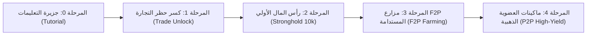

# 🗺️ مصفوفة السكربتات مفتوحة المصدر وخريطة التصعيد والربحية
## Open-Source Bot Catalog, Progression Ladder & Profit Optimization Matrix (v1.0)
> **النظام:** منظومة أتمتة OSRS Enterprise Automation  
> **المرجع:** كتالوج وتصنيف السكربتات المفتوحة (Microbot Open-Source Ecosystem)  
> **المصمم والمعماري الاستشاري:** بولا (Bolla) & زيزو (Zizo)  
> **حالة الوثيقة:** معتمدة رسمياً كمرجع تشغيلي للمنظومة  
> **المسار المستهدف للسكربتات:** `arena.ai/OSRS_Bot/` و `engines/task_worker/scripts/`  

---

## 📌 1. الركيزة الاستراتيجية (The Open-Source Advantage)

بناءً على توجيه بولا: **نعتمد على كل السكربتات المتاحة مفتوحة المصدر (Open-Source) عبر مجتمع Microbot/RuneLite**؛ لضمان تنوع هائل في الأنشطة لكل الحسابات (من الصفر وحتى العضوية الكاملة)، وتجنب بناء العجلة من الصفر، وتحقيق أعلى مرونة لتحديد الأنشطة الأكثر ربحية وأماناً.

---

## 🪜 2. سلم التصعيد الشامل (The 5-Stage Progression Ladder)

---

## 🐣 المرحلة 0: التأسيس وجزيرة التعليمات (Tutorial Island)
* **الهدف:** إخراج الحساب من الجزيرة للمين لاند في لومبريدج بأمان تام.
* **السكربت المعتمد:** `microbot-tutorial-island`
* **المتطلبات:** صفر (حساب جديد لفل 3).
* **المدة:** 12 - 15 دقيقة.
* **الناتج:** حساب جاهز في لومبريدج بكامل أدوات البداية ورصيد 25 GP.

---

## 🔓 المرحلة 1: كسر قيود التجارة (F2P Trade Unlock)
* **شروط اللعبة لفك حظر التجارة:** **7 Quest Points + 100 Total Level + 20 ساعة لعب**.
* **السكربتات المفتوحة المعتمدة لهذه المرحلة:**

| السكربت | المهارة / الكويست | الأرباح / النتيجة | الشروط |
|---|---|---|---|
| `quest_cooks_assistant` | كويست الطباخ | +1 QP + خبرة طبخ | بيضة + لبن + طحين |
| `quest_sheep_shearer` | كويست جز الصوف | +1 QP + خبرة صياغة | مقص صوف (Shears) |
| `quest_romeo_juliet` | كويست روميو وجولييت | +5 QP (قفزة ضخمة!) | بدون شروط قتالية |
| `quest_x_marks_spot` | كويست كنز فيرلوك | +1 QP + مصباح خبرة | جاروف (Spade) |
| `auto_woodcutter_lumbridge` | قطع شجر عادي ◄ أوك | Total Level + 30 لفل | فأس من البنك |
| `auto_firemaker_logs` | حرق الخشب | Total Level + 25 لفل | Tinderbox + خشب |
| `auto_fisher_shrimps_trout` | صيد سمك بلومبريدج | Total Level + 30 لفل | شبكة وصنارة |
| `auto_cooker_fish` | طبخ السمك على النار | Total Level + 25 لفل | سمك نيء |

* **الاستراتيجية الذكية:** يتم التبديل العشوائي بين الكويستات ومهام الجمع السريعة؛ وبمجرد وصول الحساب لـ 100 لفل و 7 نقاط كويست ينتهي قيد التجارة للأبد!

---

## 💰 المرحلة 2: رأس المال الأولي (Capital Bootstrapping)
* **الهدف:** جمع 10,000 GP كاش فوري لشراء معدات التدريب والعتاد.
* **السكربت المعتمد:** `microbot-stronghold-of-security`
* **الشروط:** إنهاء جزيرة التعليمات + فحص أمان اللعبة.
* **المدة:** 8 - 10 دقائق.
* **الناتج:** **10,000 GP كاش** في الشنطة + أحذية الأمان الفاخرة (Fancy Boots).
* **ملاحظة واقعية من محرك اللعبة (OSRS 2FA Invariant):**
  * تتطلب جاجيكس تفعيل التحقق الثنائي (Jagex Authenticator) على الحساب لفتح أبواب الطوابق السفلية واستلام الـ 10,000 GP كاملة من السترونجهولد.
  * **الحل التلقائي الذكي:** إذا كان الحساب مدخلاً بدون 2FA، **يتخطى المحرك هذه المرحلة فورياً وتلقائياً** وينتقل للمرحلة 3 (جمع وبيع 400 قطعة خشب أوك بالـ Grand Exchange) لجلب أول 10,000 GP كاش في 20 دقيقة فقط وبأمان تام دون الحاجة لـ 2FA!

---

## 🌾 المرحلة 3: مزارع الذهب المجانية المستدامة (F2P Sustainable Farming)
تُسند للحسابات بعد فك حظر التجارة وجمع رأس المال:

| اسم السكربت | النشاط والمكان | معدل الربح التقديري | حساسية البان (Risk) | المتطلبات |
|---|---|---|---|---|
| `draynor_oak_woodcutter` | قطع شجر أوك في درينور | **15,000 - 25,000 GP/hr** | 🟢 منخفضة جداً (Safe) | Woodcutting 15 + فأس |
| `fly_fishing_barbarian` | صيد السلمون والتراوت | **20,000 - 35,000 GP/hr** | 🟢 منخفضة | Fishing 20 + ريش |
| `cowhide_tanner_alkharid` | دباغة جلود الأبقار في الكاليد | **45,000 - 75,000 GP/hr** | 🟡 متوسطة | Crafting 1 + 2k GP كاش |
| `clay_softener_varrock` | تليين الصلصال بالماء في فاروك | **35,000 - 60,000 GP/hr** | 🟢 منخفضة (بنك فقط) | جردل ماء + صلصال خام |
| `iron_miner_alkharid` | تعدين الحديد في منجم الكاليد | **25,000 - 45,000 GP/hr** | 🟡 متوسطة | Mining 15 + فأس |
| `telegrab_zamorak_wine` | سرقة خمر زاموراك بالسحر | **80,000 - 130,000 GP/hr** | 🔴 مرتفعة (مربحة جداً) | Magic 33 + Law Runes |

---

## 👑 المرحلة 4: ماكينات العضوية والأرباح العالية (P2P High-Yield & Bond Farming)
بمجرد شراء البوند (Bond) وتفعيل العضوية، تقفز الأرباح لمستويات خيالية:

| اسم السكربت | النشاط | معدل الربح التقديري بالساعة | نوع النشاط | المتطلبات |
|---|---|---|---|---|
| `blast_furnace_steel` | صهر سبائك الستيل في البلاست فرنس | **350,000 - 550,000 GP/hr** | معالجة وسحب سريع | Smithing 30 + Ice Gloves |
| `blast_furnace_mithril` | صهر سبائك الميثريل | **500,000 - 800,000 GP/hr** | معالجة عالية القيمة | Smithing 50 + Coal Bag |
| `cannonball_smelter` | صب كرات المدفع في إيدجفيل | **180,000 - 260,000 GP/hr** | AFK طويل وأمان عالي | كويست Dwarf Cannon |
| `tan_leather_lunar` | دباغة الجلود بتعويذة اللونار | **450,000 - 750,000 GP/hr** | سحر بنكي عالي السرعة | Magic 65 + Lunar Diplomacy |
| `herb_run_farmer` | زراعة أعشاب الرانار (Ranarr) | **150,000 - 250,000 GP لكل 5 دقائق!** | زراعة دورية بين الورديات | Farming 32 + بذور |
| `high_alch_splasher` | تحويل العناصر لكاش بالسحر | **60,000 - 120,000 GP/hr** | تدريب وسحب مباشر | Magic 55 + نيران وطبيعة |
| `chaos_druids_taverley` | صيد درويد الفوضى للأعشاب | **120,000 - 200,000 GP/hr** | قتال لفل متوسط | Combat 35+ |
| `barrows_brothers_bot` | قتال إخوة الباروز للعتاد النادر | **500,000 - 1,200,000 GP/hr** | قتال وزعماء متقدم | Combat 70+ |

---

## 🧠 3. محرك تعظيم الربحية التلقائي (Dynamic Profit Optimizer Engine)

المزرعة لا تعمل بنمط عشوائي ثابت؛ بل يطبق `Accounts Manager` معادلة التفضيل الربحي:

$$\text{Task Priority Score} = \frac{\text{Historical GP/hr} \times \text{Account Eligibility}}{\text{Ban Risk Weight}}$$

* **في أول أيام الحساب:** نرجح السكربتات ذات الـ Ban Risk المنخفض (قطع الخشب والصيد والتليين) لحماية الحساب من الفلترة المبكرة.
* **بعد نضج الحساب وتجاوز أسبوعين:** نرفع تدريجياً حصة سكربتات الإنتاجية العالية (دباغة الجلود وخمر زاموراك وصهر الستيل).
* **المراقبة والتحديث الحي:** السكربت الذي يثبت بالتقرير المالي في التليجرام أنه يحقق أعلى GP/hr مع صفر تعثر، يعطيه المحرك وزناً أعلى في القرعة التلقائية.

---

## 🔗 4. التكامل الهندسي مع محركات المنظومة:
1. **مع المحرك الأول (`Task Worker`):** كل سكربت في هذا الكتالوج يستخدم دالة تصفير البنك `execute_bank_turnaround` لسحب أدواته ومواده بالاسم.
2. **مع المحرك الثاني (`Accounts Manager`):** يقوم بمطابقة الحساب مع هذا الكتالوج عبر `find_best_compatible_script` استناداً لشروط الجدول أعلاه.
3. **مع المحرك الثالث (`Telegram Guardian`):** يبث تقارير الـ GP المكتسب لكل سكربت في ملخص نهاية الجلسة لحساب دراسة الجدوى بدقة.

---

✅ **تم التوثيق والاعتماد:** بولا & زيزو  
📅 **التاريخ:** 2026-10-22
